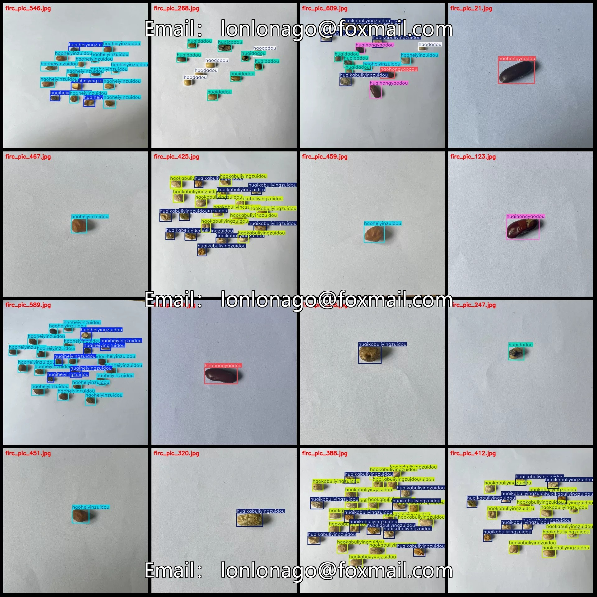
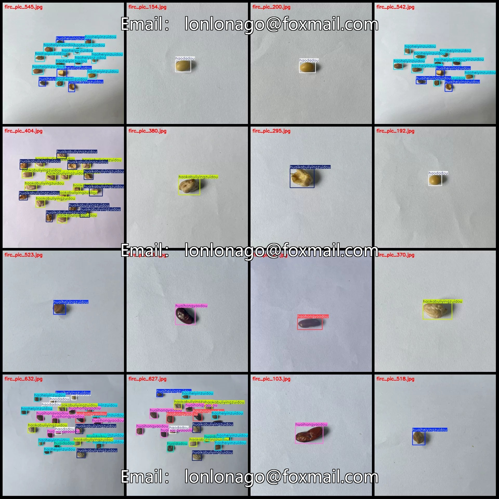
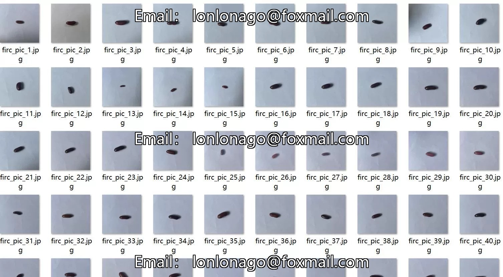
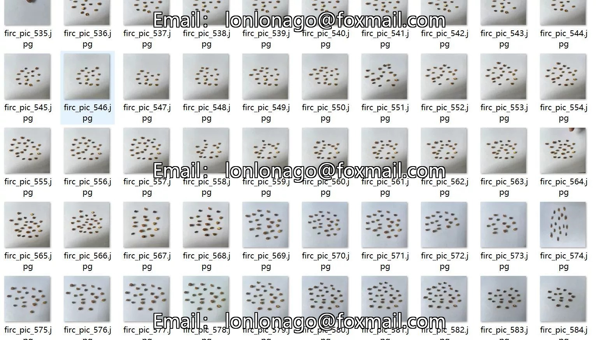
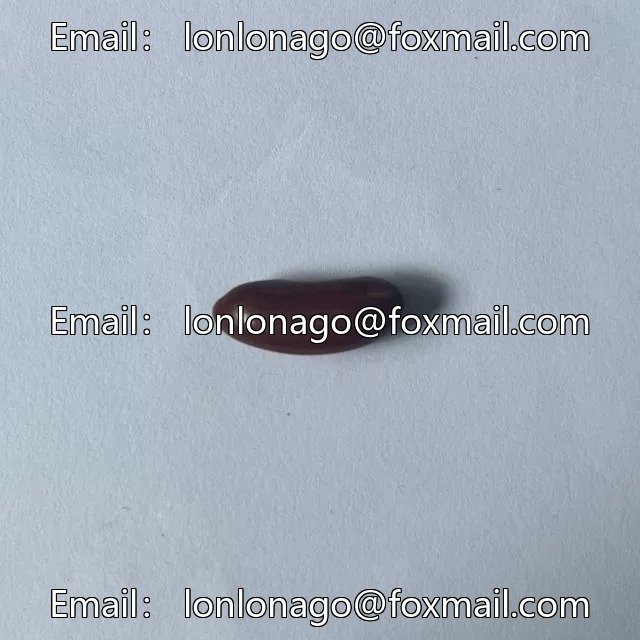
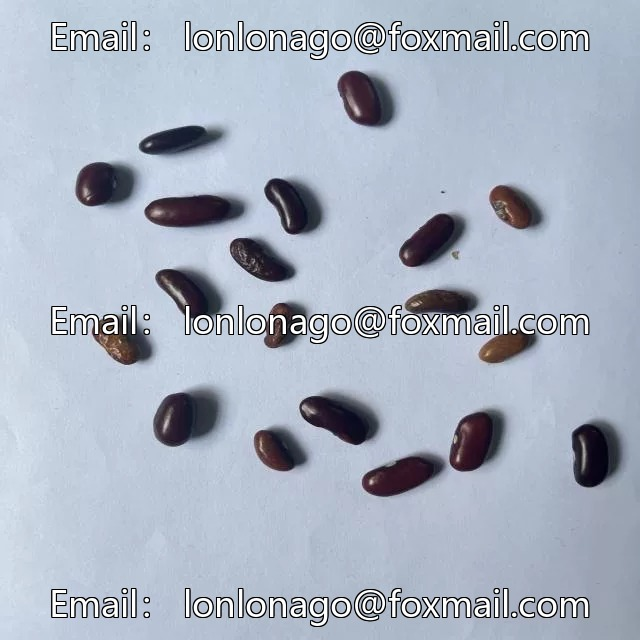
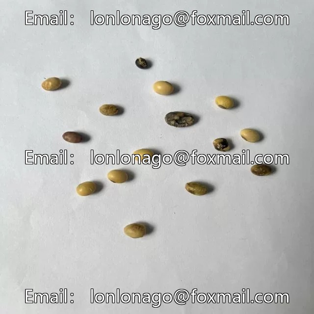

# Peanut and bean seed quality inspection dataset - good/bad classification detection dataset VOC+YOLO format 633 images 8

## Body

Tomato Seed Quality Inspection Classification Detection Dataset (VOC+YOLO format, 633 images in 8 categories)

Precaution: Due to the dataset's replicability, please confirm compliance with requirements before purchasing.

Dataset format: Pascal VOC format + YOLO format (txt file without split path, only containing jpg images and corresponding VOC format xml files and yolo format txt files).
Number of images (number of jpg files): 633
Number of annotations (number of xml files): 633
Number of annotations (number of txt files): 633
Number of annotation categories: 8

Label category names (Note that the order of categories in the YOLO format does not correspond to this, but is based on the labels folder's classes.txt): ["haodadou", "haoheiyinzuidou", "haohongyaodou", "haokabuliyingzuidou", "huaidadou", "huaiheiyingzuidou", "huaihongyaodou", "huaikabuliyingzuidou"]

- "Good soybeans", "Good black kidney beans", "Good red kidney beans", "Good Kabuli kidney beans", "Bad soybeans", "Bad black kidney beans", "Bad red kidney beans", "Bad Kabuli kidney beans"
Number of frames and images per category
haodadou = 327, occupying 113 images
haoheiyinzuidou = 858, occupying 148 images
haohongyaodou = 622, occupying 142 images
haokabuliyingzuidou = 677, occupying 144 images
huaidadou = 404, occupying 113 images

Huaiheiyingzuidou Frames = 532, Pictures = 140
Huaihongyaodou Frames = 550, Pictures = 142
Huikabuliyingzuidou Frames = 621, Pictures = 145
Total Frames: 4591
Image Resolution: 640x640
Labeling Tool: labelImg
Labeling Rules: Draw a rectangle around the category.
Important Notice: The dataset does not have separate training, validation, and test sets; you need to manually divide them.
Special Remark: This dataset does not guarantee the accuracy of the trained models or weight files.

## Images

## Payment

Here is a pay link on Stripe ( https://buy.stripe.com/3cs8yP7sY87d0vu9AB ). Please contact me lonlonago@foxmail.com after funding $89, and I will send you a complete data files , thank you!

